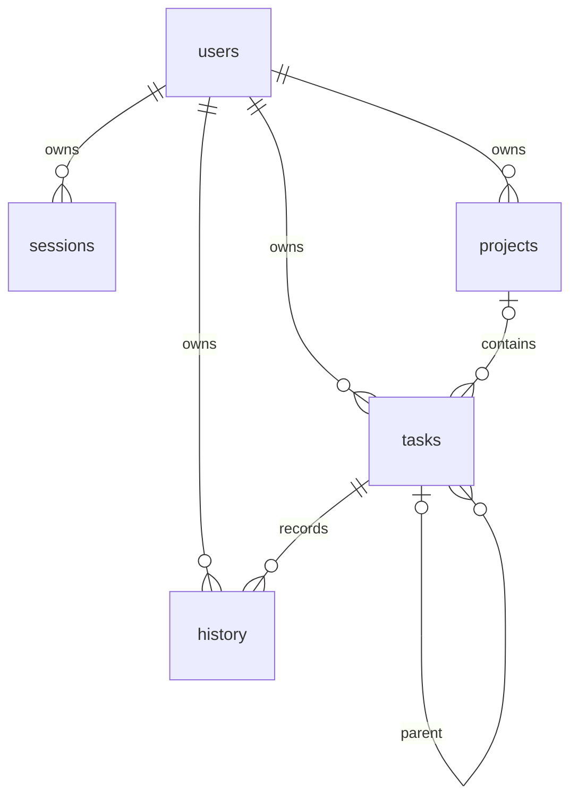

# To-Do

Локальное приложение для отдельных пользователей: FastAPI, SQLite и русский интерфейс. Регистрация через веб отключена. Даты задач — календарные, «сегодня» определяется в часовом поясе Europe/Moscow. Рабочие данные находятся в томе Docker.

## Запуск

Установите Docker и Compose, затем выполните в каталоге проекта:

```sh
docker compose up -d --build
docker compose exec todo python -m app.cli create-user alice
```

Команда запросит пароль без отображения. Откройте http://127.0.0.1:18080. Доступ привязан к локальному интерфейсу; для публикации в сети потребуется настроить HTTPS и защиту на обратном прокси. Существующий том `todo_data` содержит данные и не должен удаляться при обычном обновлении.

Для начального создания ровно трёх пользователей подготовьте **вне репозитория** JSON-файл вида `[{"username":"...","password":"..."}, ...]` и передайте его в контейнер через stdin:

```sh
docker compose exec -T todo sh -c 'cat > /tmp/bootstrap.json && python -m app.cli bootstrap /tmp/bootstrap.json; code=$?; rm -f /tmp/bootstrap.json; exit $code' < users.json
```

Храните и передавайте такой файл только доверенным способом, удалите его после использования. В PowerShell вместо перенаправления используйте поток байтов или отдельную команду `create-user` для каждого пользователя. Логин — 1–200 символов, пароль — 8–1000. Для неинтерактивного создания отдельного пользователя поддерживается `--password-file`.

## Разработка

```sh
python -m venv .venv
# Windows: .venv\Scripts\python.exe; Linux/macOS: .venv/bin/python
.venv/bin/python -m pip install -r requirements-dev.txt
.venv/bin/python -m uvicorn app.main:app --host 127.0.0.1 --port 18080
.venv/bin/python -m pytest -q
```

Путь БД задаётся `TODO_DB`, по умолчанию `data/todo.sqlite3`. Для создания пользователя вне контейнера используйте `.venv/bin/python -m app.cli create-user alice`. При разработке храните базу и пароли отдельно от исходников. Инструкция по модели — [словарь БД](docs/database.md).

Сеанс хранится в HttpOnly/SameSite cookie, в БД записан только хеш случайного токена. Для изменяющих запросов необходим CSRF-токен, дополнительно проверяется Origin. Пароли хешируются scrypt с солью. Защита от перебора и капчи хранятся в памяти одного процесса, поэтому приложение следует запускать одним процессом; при перезапуске счётчики сбрасываются. Удаление дерева требует подтверждения точного состава, а пакетный перенос изменяет только выбранные задачи.

## Windows PowerShell

```powershell
python -m venv .venv
.\.venv\Scripts\python.exe -m pip install -r requirements-dev.txt
.\.venv\Scripts\python.exe -m app.cli create-user alice
.\.venv\Scripts\python.exe -m uvicorn app.main:app --host 127.0.0.1 --port 18080
```

Создание трёх пользователей в запущенном контейнере без помещения паролей в образ:

```powershell
Get-Content -Raw -Encoding UTF8 C:\path\users.json | docker compose exec -T todo sh -c 'cat > /tmp/bootstrap.json && python -m app.cli bootstrap /tmp/bootstrap.json; code=$?; rm -f /tmp/bootstrap.json; exit $code'
```

На главной доступны четыре виджета, быстрый ввод и перенос выбранных задач. Разделы внепроектных и всех задач дают поиск, фильтры, список и дерево. Проекты создаются и редактируются, задачи можно открыть, редактировать, дублировать и удалять с предварительным списком потомков. Статусы переключаются независимо у каждого узла: завершение родителя не меняет статусы дочерних задач. Связанные задачи должны принадлежать одному проекту; недопустимые смены проекта или циклы отклоняются. Markdown проходит серверную фильтрацию HTML.

## Резервная копия и восстановление

Остановите приложение (`docker compose stop`), затем сохраните содержимое тома с помощью системного средства резервного копирования Docker или скопируйте файл SQLite из смонтированного тома. Копия должна содержать сам файл `todo.sqlite3` и храниться в защищённом месте. Для восстановления остановите приложение, замените файл БД проверенной копией в том же томе и запустите `docker compose up -d`; предварительно сохраните текущую базу. Не удаляйте том при пересоздании контейнера. Для локального режима при остановленном сервере достаточно скопировать файл, указанный `TODO_DB`.



Публикация в GitHub запрещена действующими инструкциями. Машиночитаемые описания всех столбцов находятся в `app/schema-descriptions.json`; тест сверяет их с реальной схемой SQLite.

Compose использует стандартную сеть Docker `bridge` (`network_mode: bridge`): приложение состоит из одного контейнера и не требует отдельной сети, а создание новых сетей может быть недоступно при исчерпанном пуле подсетей Docker. Порт по-прежнему привязан к `127.0.0.1`.

Шрифты Inter и Manrope хранятся в `app/static/fonts` вместе с лицензиями OFL. После сборки интерфейс не обращается к внешним серверам за шрифтами.

## Проверки

```powershell
.\.venv\Scripts\python.exe -m pytest -q --basetemp artifacts/api-check
python -m venv .qa-venv
.\.qa-venv\Scripts\python.exe -m pip install -r requirements-qa.txt
.\.qa-venv\Scripts\python.exe -m playwright install chromium
.\scripts\check-browser.ps1
```

Браузерный сценарий собирает образ, создаёт одноразовый контейнер на `127.0.0.1:18081` с базой в tmpfs, проверяет интерфейс в headless Chromium, сохраняет отчёт и снимки в `artifacts/browser-final`, затем удаляет контейнер в `finally`. Рабочие пользователи и том данных не затрагиваются. Для уже установленного Chromium можно указать путь в переменной `TODO_QA_CHROMIUM`. При занятом тестовом порте используйте `-Port 18082`. API-тесты создают отдельные базы, не обращаясь к рабочему контейнеру.

Пример резервирования и восстановления в PowerShell для стандартного Compose-проекта (имя файла копии укажите своё):

```powershell
# Остановить сервер, чтобы получить согласованную копию SQLite.
docker compose stop todo
$todoContainer = docker compose ps -aq todo
docker cp "${todoContainer}:/data/todo.sqlite3" .\todo-backup.sqlite3
docker compose start todo

# Восстановление: сначала сохранить текущую базу отдельной копией.
docker compose stop todo
docker cp "${todoContainer}:/data/todo.sqlite3" .\todo-before-restore.sqlite3
docker cp .\todo-backup.sqlite3 "${todoContainer}:/data/todo.sqlite3"
# docker cp может назначить root владельцем; вернуть права процессу приложения.
docker compose run --rm --no-deps --user root --entrypoint chown todo 10001:10001 /data/todo.sqlite3
docker compose start todo
```

Команда `run --rm` создаёт одноразовый контейнер для исправления владельца файла и удаляет его по окончании. Храните резервные копии вне репозитория и не передавайте посторонним: они содержат задачи пользователей и хеши паролей.
